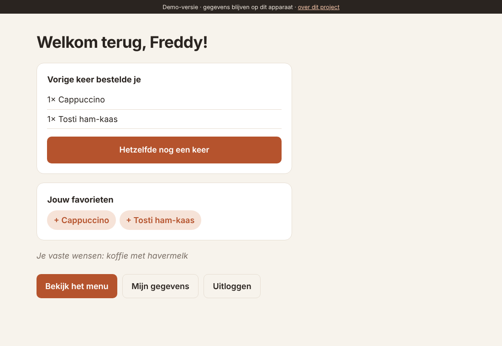
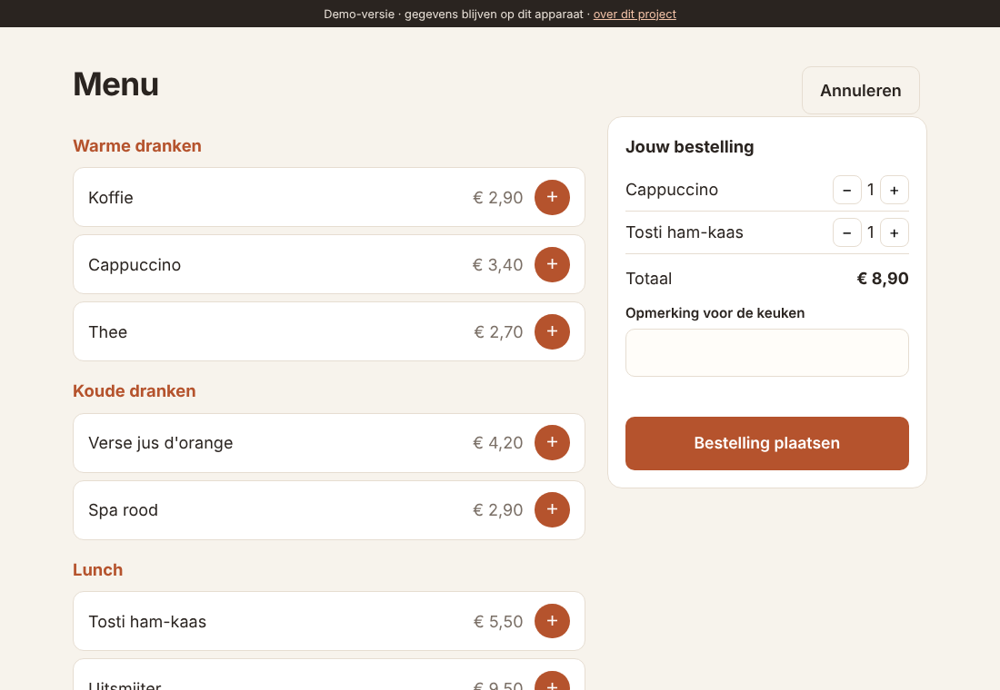

# Welkom Terug

**Een persoonlijk menu voor kleine horecazaken, zonder app.**

Een tablet bij de ingang herkent vaste gasten aan hun voornaam en een pincode van vier cijfers. Daarna staat hun vorige bestelling klaar en bestellen ze met één tik opnieuw. De gast hoeft niets te installeren en de zaak heeft geen duur kassasysteem nodig.

**Live demo:** https://freed-cloud.github.io/welkom-terug/

| Terugkerende gast | Menu op de tablet |
| --- | --- |
|  |  |

## Waarom
In mijn tijd in de horeca zag ik het elke dag: vaste gasten bestellen steeds hetzelfde, maar moeten het toch elke keer opnieuw uitleggen. Grote ketens lossen dat op met een app en een spaarprogramma. Voor een kleine zaak is dat te duur, en gasten willen niet voor elke zaak een app. Welkom Terug geeft kleine zaken dat persoonlijke gevoel zonder app.

## Zo werkt het
**Voor de gast**
1. Op de tablet bij de ingang vult de gast zijn voornaam en pincode in, of maakt een profiel aan (met toestemming).
2. Het scherm toont *Welkom terug!*, de vorige bestelling, favorieten en vaste wensen ("koffie met havermelk").
3. Met *Hetzelfde nog een keer* staat de bestelling direct klaar. Of de gast kiest iets anders uit het menu.
4. De bestelling gaat naar het beheerscherm van de keuken.
5. Bestellen zonder profiel kan ook.

**Voor het personeel** (achter een eigen pincode)
- Bestellingen volgen: nieuw → in bereiding → klaar → afgehandeld
- Menu beheren: gerechten, categorieën, prijzen en beschikbaarheid
- Gastprofielen bekijken, ontgrendelen en verwijderen
- Naam van de zaak en de bewaartermijn instellen

## Privacy by design
- **Toestemming vooraf:** zonder vinkje wordt er geen profiel bewaard.
- **Dataminimalisatie:** alleen voornaam, vaste wensen en de laatste 30 bestellingen. Geen e-mail, telefoonnummer of achternaam.
- **Bewaartermijn:** profielen worden automatisch verwijderd na een instelbaar aantal dagen zonder bezoek (standaard 180).
- **Inzage en verwijdering:** de gast ziet onder *Mijn gegevens* alles wat er bewaard is, kan het downloaden en verwijdert zijn profiel met één knop (AVG art. 15, 17 en 20).
- **Privacy op een gedeeld scherm:** na 90 seconden zonder aanraking gaat de tablet terug naar het begin, en op het beginscherm staat nooit iets van de vorige gast.

## Beveiliging
- Pincodes worden **nooit** opgeslagen, alleen een PBKDF2-SHA-256-hash met eigen salt per profiel (150.000 rondes).
- Vergelijking van hashes in constante tijd.
- Na 5 foute pogingen gaat een profiel of het beheerscherm 15 minuten op slot.
- Geen hint of een naam bestaat ("we herkennen deze combinatie niet").
- Zwakke pincodes (1111, 1234, 123456) worden geweigerd.
- Strikte Content Security Policy, geen inline code, geen externe scripts, geen verbindingen naar buiten.
- Alle invoer wordt als tekst weergegeven (bescherming tegen XSS) en ingekort tot een maximale lengte.
- Clickjacking-bescherming en `no-referrer`.

Meer details en bekende beperkingen: [SECURITY.md](SECURITY.md)

## Techniek
- HTML, CSS en JavaScript, zonder frameworks of externe libraries
- Web Crypto API voor het hashen van pincodes
- `localStorage` als opslag in deze demo
- Gehost via GitHub Pages

## Status en roadmap
Dit is een **werkende demo op één apparaat**. Voor gebruik in een echte zaak zijn deze stappen nodig:
- [ ] Backend met versleutelde database, zodat meerdere tablets en het keukenscherm dezelfde gegevens zien
- [ ] Keukenscherm op een apart apparaat, met geluid bij een nieuwe bestelling
- [ ] Koppeling met een kassasysteem
- [ ] Meertalig menu (Nederlands, Duits en Engels, handig in de grensregio)
- [ ] Allergenen per gerecht tonen
- [ ] Verwerkersovereenkomst en privacyverklaring voor de horecazaak
- [ ] Pilot bij een kleine zaak in Venlo

## Wat ik hiervan heb geleerd
- Een idee uit de praktijk vertalen naar een werkend product
- Veilig omgaan met inloggegevens: hashen met salt, rate limiting en lockout
- Privacy by design en de AVG in de praktijk: toestemming, bewaartermijn, inzage en verwijdering
- Webbeveiliging: Content Security Policy, XSS voorkomen, clickjacking
- Gebruiksvriendelijk ontwerpen voor een tablet die door veel mensen wordt gebruikt

Gemaakt door Freddy den Haan – [portfolio](https://freed-cloud.github.io/)
